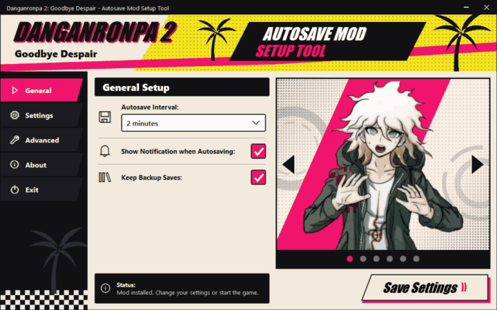
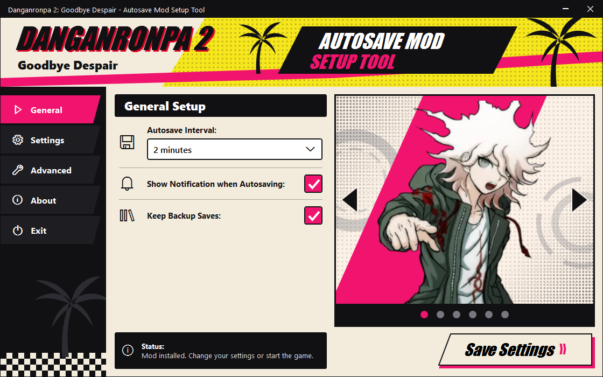
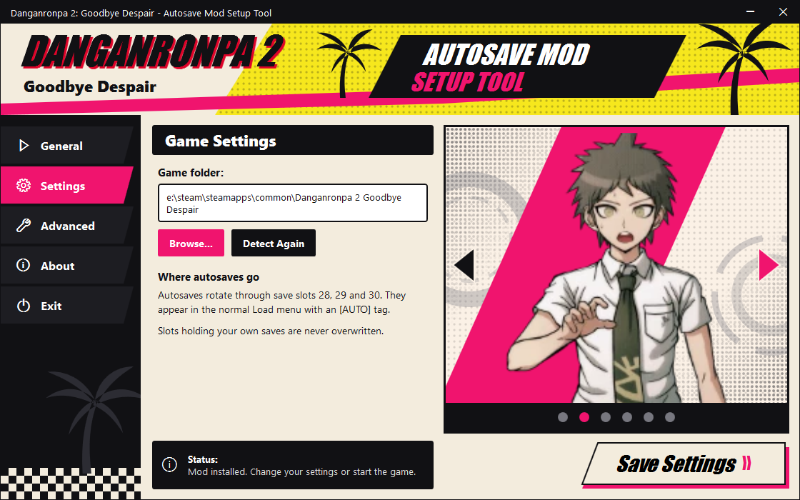
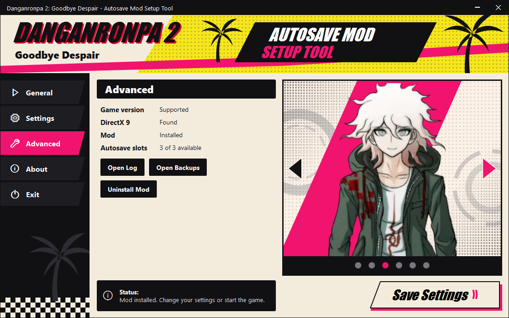
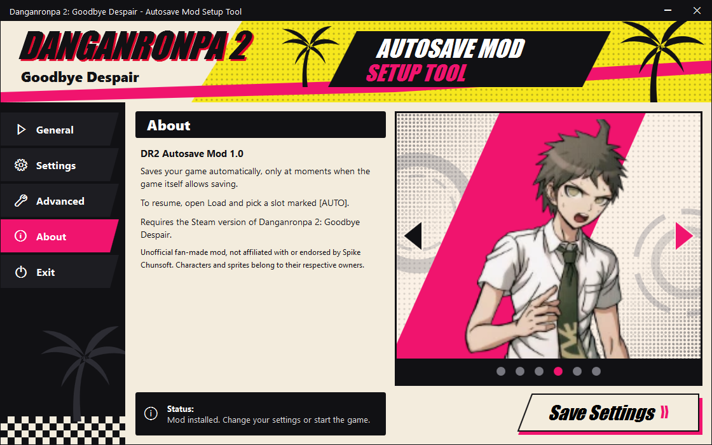

# Danganronpa 2: Goodbye Despair - Autosave Mod

An unofficial autosave mod for the Steam version of **Danganronpa 2: Goodbye Despair**, with a graphical setup tool.



## Features

- **Automatic saves** every 2, 5, 10, 15 or 30 minutes.
- **Safe timing:** the mod only saves when the game's own conditions for saving are met.
- **Three rotating slots:** autosaves use slots 28, 29 and 30 and appear in the normal Load menu with an `[AUTO]` tag.
- **Your saves stay yours:** slots that hold your own saves are never overwritten.
- **Backups:** keeps the last five copies of your save file, plus a copy from before the mod's first run.
- **On-screen notification** when an autosave happens (optional).
- **Easy removal:** uninstall from the setup tool at any time. Your saves are kept.

## Screenshots

| General | Settings |
| --- | --- |
|  |  |

| Advanced | About |
| --- | --- |
|  |  |

## Install

1. Download `DR2_Autosave_Mod_1.0.zip` from the [latest release](../../releases/latest) and extract it.
2. Close the game.
3. Run `DR2_Autosave_Setup.exe`.
4. Choose your settings and press **Install Mod**.

The setup finds the Steam copy of the game automatically. If it does not, open **Settings** and choose the game folder.

Windows may show a warning because the setup is not digitally signed.

To resume from an autosave, open **Load** in the game and pick a slot marked `[AUTO]`.

## Requirements

- Windows 10 or 11
- The current Steam version of Danganronpa 2: Goodbye Despair (`DR2_us.exe`)

Other versions of the game are detected and refused, so the mod is never installed on a build it does not support.

## Known limitations

- The notification may not be visible if the game runs in exclusive fullscreen. The autosave still happens.
- If slots 28, 29 and 30 all hold your own saves, the mod has no free slot and stays disabled.

## Uninstall

Run the setup, open **Advanced** and press **Uninstall Mod**.

## Build from source

You need Visual Studio with the C++ desktop and .NET desktop workloads, plus the .NET Framework 4.7.2 targeting pack. The Visual Studio paths are set in `build.bat` and `package.bat`, so adjust them if your installation differs.

```bat
package.bat
```

The setup is written to `dist\DR2_Autosave_Setup.exe`.

| Path | Contents |
| --- | --- |
| `dr2_autosave.c` | The mod, loaded by the game as `d3dx9_43.dll` |
| `notify.h` | In-game notification banner |
| `vfs.h` | Save file reader |
| `setup/` | Graphical setup tool (WPF) |

## Disclaimer

This is a fan-made project, not affiliated with or endorsed by Spike Chunsoft. Danganronpa, its characters and its sprites belong to their respective owners. Back up your saves before using any mod.
